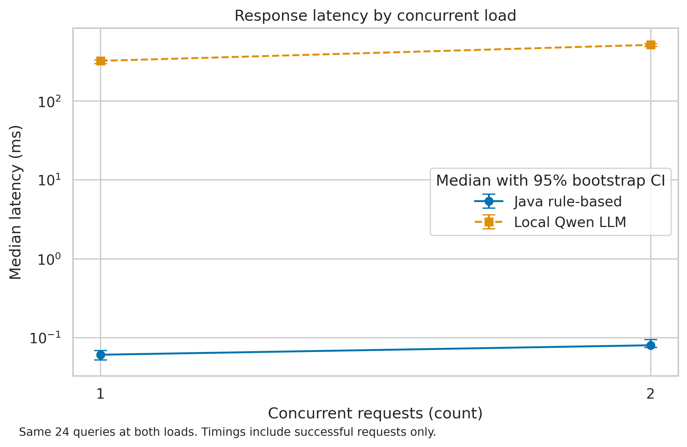
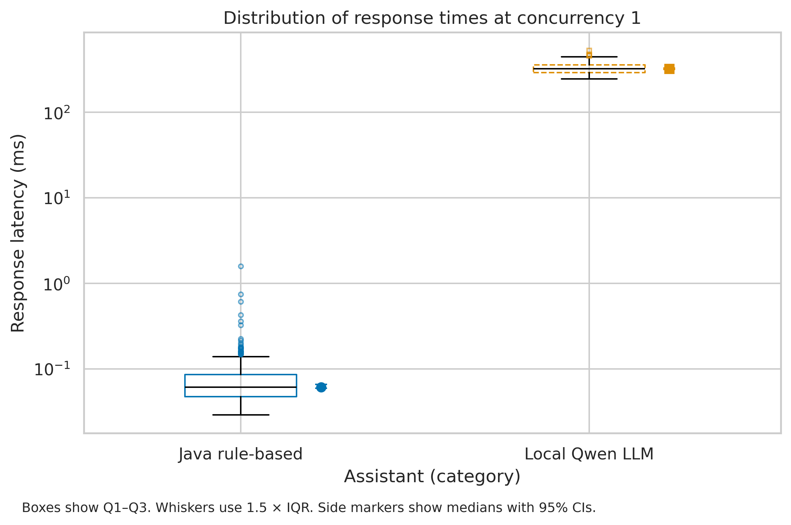

# WhatsApp AI CRM Benchmark

Task 3 compares the existing Java keyword assistant with a local Qwen2.5-0.5B-Instruct model on the same synthetic WhatsApp-style customer queries. The primary outcome is correct classification into one of six intent labels. The secondary experiment tests response time at two levels of concurrency.

## Results & Discussion

Primary comparison at concurrency 1. Both systems processed 108 unique queries in English, Russian, and Kazakh (18 per intent), with three repetitions per query. Failed requests count as incorrect for intent accuracy. Latency summaries use successful responses.

| Metric | Java rule-based baseline | Local Qwen LLM |
|---|---:|---:|
| Intent accuracy, % [95% bootstrap CI] | 16.67 [10.19, 24.07] | 38.89 [29.63, 48.15] |
| Mean latency, ms | 0.0843 | 330.40 |
| Median latency, ms [95% bootstrap CI] | 0.0615 [0.0597, 0.0661] | 323.32 [316.70, 330.73] |
| P95 latency, ms | 0.1639 | 421.82 |
| Request errors, % (count) | 0.00 (0/324) | 2.78 (9/324) |
| CRM case-reference completeness, % (exact matches) | 0.00 (0/18) | 83.33 (15/18) |

The accuracy gain was **22.22 percentage points**, with a paired 95% bootstrap CI of **[8.33, 35.19] pp**. The one-sided exact McNemar test on first-repeat outcomes gave **p = 0.001335** (42 LLM-only correct, 18 baseline-only correct). At α = 0.05, the data support an accuracy improvement on this test set. The lower CI bound is below 10 pp, so the minimum practical gain of 10 pp was not confirmed. Both systems had low absolute accuracy. In this run, Qwen correctly classified none of the 18 unique support messages and none of the 18 fallback messages.

The LLM met the observed P95 threshold of 5000 ms and the observed request-error threshold of 5%. The nine primary errors were output-validation failures across three distinct queries. CRM case-reference completeness missed the 90% threshold. The 18 attempts for this field represent six unique reference-bearing queries repeated three times. The original Java baseline has no CRM extraction. The LLM also emitted a reference in three successful attempts whose ground truth had no reference.

At matched loads of one and two concurrent requests on the same 24 queries, LLM median latency rose from **323.42 ms** to **515.78 ms**. The intervals quantify median uncertainty. The experiment covers only these two levels.





[Vector PDF for the load figure](reports/figures/fig1_latency_vs_load.pdf) · [Vector PDF for the box plot](reports/figures/fig2_distribution_boxplot.pdf) · [C4 container model and measurement points](docs/domain_model.md)

## Method

- The inherited Java keyword rules and fixed priority order are unchanged. A streaming entry point reuses them so JVM startup is outside request timing.
- Expected intent labels and optional ticket references were assigned before capture. The original 10-question sample remains for the Task 2 smoke test. The 108-query evaluation dataset is independent of that sample. At each load and for each system, four warm-up requests precede the three evaluation repetitions.
- The raw capture contains 808 attempts, including 16 warm-up and 792 evaluation rows. Each evaluation row records phase, assistant, query ID, concurrency, repetition, outcome, duration and expected fields. Requests are paired by query ID within the same load and repetition.
- Bootstrap resamples query IDs with replacement 2,000 times at seed 42 and retains all repetitions of a selected query. It preserves the system pairing for the accuracy difference. Exact McNemar uses the first repetition to provide one outcome per system per unique query. Its null for the one-sided test is that the probability of an LLM-only win is at most the probability of a baseline-only win.
- P95 is the empirical 95th percentile of successful durations. CRM case-reference completeness is the fraction of attempts with an annotated required reference that return that exact value. Latency and CRM guardrails are assessed descriptively.
- The benchmark measures the Python client's elapsed time across Java IPC or localhost HTTP plus inference. It excludes WhatsApp transport, the quality of a user-facing reply and real CRM writes. The synthetic, balanced dataset, one small CPU model and six reference-bearing messages limit generalization.

## Reproduce the analysis

Use Python 3.12. The checked-in raw capture is small and can be analyzed without Java, a model download, or an API key.

```bash
python -m pip install -r requirements.txt
python src/process_data.py
python src/visualize.py
```

Open [the executed notebook](notebooks/01_data_analysis.ipynb) in Jupyter or VS Code, select the same Python environment, and choose **Restart Kernel and Run All Cells**. It regenerates the processed CSV and both figure formats. For the browser-based Jupyter interface, install and start JupyterLab separately with `python -m pip install jupyterlab` and `python -m jupyter lab`.

## Collect new measurements

Use Java 17 or later and llama.cpp release [b6500](https://github.com/ggml-org/llama.cpp/releases/tag/b6500). Download the [Qwen2.5-0.5B-Instruct Q4_K_M GGUF](https://huggingface.co/Qwen/Qwen2.5-0.5B-Instruct-GGUF) with SHA-256 `74a4da8c9fdbcd15bd1f6d01d621410d31c6fc00986f5eb687824e7b93d7a9db`. Start the model server, then run the collector in a second terminal.

```bash
llama-server -m qwen2.5-0.5b-instruct-q4_k_m.gguf --alias qwen --host 127.0.0.1 --port 8080 -t 4 -np 2 -c 2048
```

```bash
python src/benchmark.py --output data/raw/local_run.jsonl
```

The collector uses a fixed prompt and config. The published capture used OpenJDK 21, Python 3.12, CPU inference with four model threads, two model slots and prompt caching. Hardware and runtime details are in [capture metadata](data/raw/test_run.metadata.json). To analyze a new capture with the provided commands, back up the reference files and set the analysis input to the new capture. Timing will vary by hardware and system load. The existing Java smoke test still runs via `java src/main/java/benchmark/Main.java` or the original Maven/Docker workflow.

## Repository map

| Path | Purpose |
|---|---|
| `data/sample/evaluation_questions.csv` | 108 frozen synthetic questions and ground truth |
| `data/raw/test_run.jsonl` | Compact captured reference measurements |
| `data/processed/metrics_summary.csv` | Primary and matched-load summaries |
| `src/benchmark.py` | Data collection and raw logging |
| `src/process_data.py` | Filtering, validation and statistics |
| `src/visualize.py` | Figure generation and export |
| `notebooks/01_data_analysis.ipynb` | Executed analysis with saved output |
| `docs/domain_model.md` | C4 container view |
| `reports/Task_3_Report.md` | Report for submission |
| `reports/figures/` | Figures in PDF and 300 DPI PNG |

The inherited Java project is distributed under the MIT License. See [LICENSE](LICENSE).
