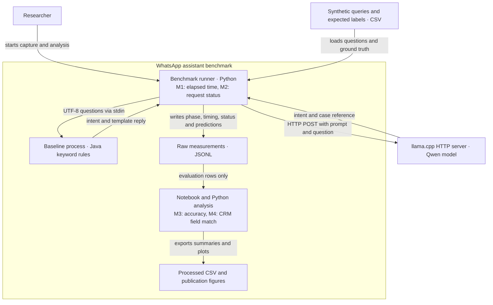

# C4 container view

The boundary is the Task 3 experimental benchmark. The benchmark uses synthetic WhatsApp-style messages and evaluates routing and ticket-reference extraction. The local model server is a separate runtime dependency.

| Point | Metric | Collection boundary |
|---|---|---|
| M1 | Response latency, ms | Python monotonic clock around each request, including the relevant IPC or localhost HTTP path. |
| M2 | Request error rate, % | Runner records success or an exception for every attempt. |
| M3 | Intent accuracy, % | Analysis matches the predicted intent against the frozen label. A request failure is incorrect. |
| M4 | Case-reference completeness, % | Analysis checks exact matches on requests annotated with a required reference. |

The experiment covers one CRM field, `case_ref`, from synthetic messages. The WhatsApp gateway, reply quality, and live CRM storage are outside this benchmark boundary.
