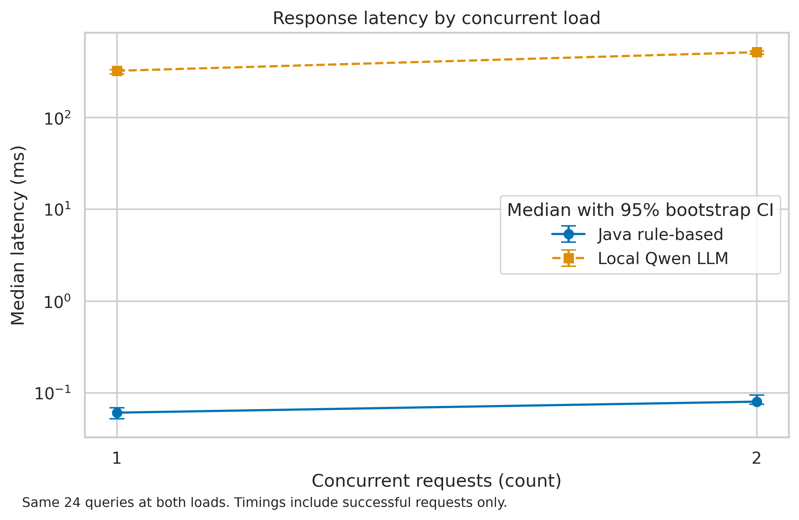
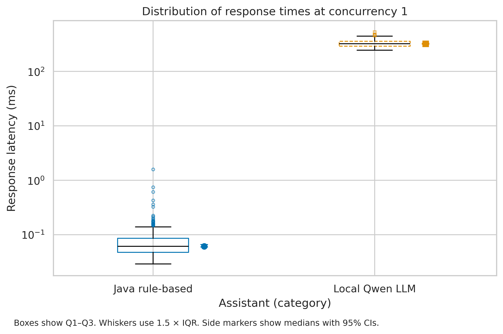

# Task 3 Research Results and Scientific Visualization

## Research question

Does a local LLM assistant achieve better intent-classification accuracy than a rule-based Java assistant on the same synthetic WhatsApp-style queries, and does it meet the planned latency, reliability and CRM field targets?

## Experimental design

The paired experiment evaluated the original Java keyword rules and Qwen2.5-0.5B-Instruct Q4_K_M on 108 labeled queries at concurrency 1. Queries cover six intents and three languages. Each system processed the same queries three times. Four warm-up requests per system and load were marked in the raw log and filtered by phase. The supplementary load experiment held a 24-query subset fixed at concurrency 1 and 2. There were 808 logged attempts, of which 16 were warm-up and 792 were evaluation.

Errors count as incorrect predictions and remain in the error-rate denominator. Timing summaries use successful responses. The 95% confidence intervals use 2,000 bootstrap resamples of query IDs at seed 42, retaining all repetitions for each selected query. The paired accuracy interval uses paired differences. A one-sided exact McNemar test uses the first repetition per unique query.

## Results

| Metric at concurrency 1 | Java rule-based | Local Qwen |
|---|---:|---:|
| Accuracy, % [95% CI] | 16.67 [10.19, 24.07] | 38.89 [29.63, 48.15] |
| Median latency, ms [95% CI] | 0.0615 [0.0597, 0.0661] | 323.32 [316.70, 330.73] |
| P95 latency, ms | 0.1639 | 421.82 |
| Request error rate, % | 0.00 (0/324) | 2.78 (9/324) |
| CRM case-reference completeness, % | 0.00 (0/18) | 83.33 (15/18) |

The paired difference was **+22.22 pp**, with a 95% CI of **[8.33, 35.19] pp**. The first repetition contained 42 pairs where only Qwen was correct and 18 where only the baseline was correct. The one-sided exact McNemar p-value was **0.001335**. At α = 0.05, the data support a positive accuracy difference on these queries. The practical target of a gain of at least 10 pp was not confirmed because the confidence interval includes smaller gains.

Qwen passed the observed P95 limit of 5,000 ms and the error-rate limit of 5%. The nine primary failures were output-validation errors. It missed the 90% CRM field target and failed to correctly classify any support or fallback query. For the matched 24-query subset, its median response time rose from 323.42 ms at one concurrent request to 515.78 ms at two. This result characterizes two tested load levels on the recorded host.

Both figures show latency in milliseconds on a logarithmic scale. Figure 1 uses error bars for median confidence intervals. Figure 2 shows the interquartile range and separate median intervals. Both are exported as vector PDF and 300 DPI PNG.

## Scope and reproducibility

Messages were synthetic and labels were assigned before capture. The CRM metric covers extraction of one case-reference field from six unique annotated messages. The latency measurement includes each system's local communication path and processing. It does not include live WhatsApp delivery, answer quality or CRM storage. Larger and representative datasets are required to estimate field performance.

See the [executed notebook](../notebooks/01_data_analysis.ipynb), [C4 model](../docs/domain_model.md), [raw logs](../data/raw/test_run.jsonl), [summary CSV](../data/processed/metrics_summary.csv), and [reproduction instructions](../README.md).
